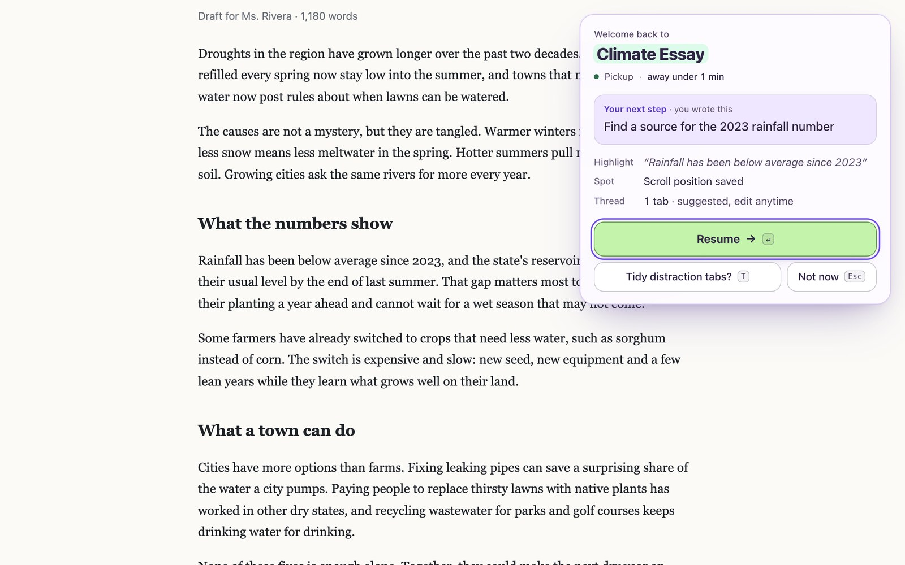

# Pickup

Pickup is a Chrome extension that saves your place when you leave your work and hands it back when you return. Come back to a work tab and a small card shows the task, how long you were away, the next step you wrote and the sentence you were on; press Enter and you are back at the same spot.

**Website:** https://marvinridgemt.github.io/Teens-Hack-Houston-Hackathon/ · **Download:** [pickup-v1.0.1.zip](https://github.com/MarvinRidgeMT/Teens-Hack-Houston-Hackathon/releases/latest/download/pickup-v1.0.1.zip) ([release notes](https://github.com/MarvinRidgeMT/Teens-Hack-Houston-Hackathon/releases/latest))



## Install in 4 steps

1. Download [`pickup-v1.0.1.zip`](https://github.com/MarvinRidgeMT/Teens-Hack-Houston-Hackathon/releases/latest/download/pickup-v1.0.1.zip) from this repo's [latest release](https://github.com/MarvinRidgeMT/Teens-Hack-Houston-Hackathon/releases/latest) and unzip it.
2. Open `chrome://extensions` in Chrome (or `edge://extensions` in Edge).
3. Turn on **Developer mode** (top right).
4. Click **Load unpacked** and pick the unzipped `pickup-v1.0.1` folder (the one that contains `manifest.json`; Windows' Extract All may nest it one level down).

Pickup isn't on the Chrome Web Store. It needs Chrome 123 or newer.

## First run

The setup page opens on install. Add your **work sites** (for example `docs.google.com`, `wikipedia.org`) and your **distraction sites** (for example `youtube.com`), then click **Save and start** and allow site access when Chrome asks. Pickup only runs on the work sites you list.

## Try it without your own data

Open the dashboard (toolbar popup → Dashboard) and click **Load sample data**.

## Shortcuts

<!-- shortcuts-table:start (check-integration allows key names inside this table) -->
| What it does | Mac | Windows, Linux, ChromeOS | Without the keyboard |
|---|---|---|---|
| Park before you go (save your place and a next step) | ⌃⇧P (Control+Shift+P) | Alt+P | Park in the toolbar popup |
| Back to your task from any tab | ⌃⇧R (Control+Shift+R) | Alt+R | Resume in the popup, or the panel's task list |
| Open the Pickup panel | ⌃⇧V (Control+Shift+V) | Alt+V | Open Pickup panel in the popup |
| Wrap up for today | not set | not set | Wrap up in the popup |
| Resume, on the return card | Enter | Enter | Click Resume |
<!-- shortcuts-table:end -->

Change any of them at `chrome://extensions/shortcuts`. Pickup's own pages always show the keys you actually have.

**If you had Pickup installed before v1.0:** Chrome keeps your old keys. New suggested keys only apply to a fresh install, so remove Pickup and load v1.0 again, or set the keys at `chrome://extensions/shortcuts`. If another extension already uses one of these keys, Chrome leaves it unset and Pickup shows "Not set".

Mac uses Control+Shift because Chrome already uses Command+Shift+R (hard reload) and Command+Shift+V (paste and match style), and Option+letter types special characters on a Mac.

## Works on

Chrome or Edge on Windows, Mac, Linux and ChromeOS. Not on phones: mobile browsers don't support extensions. Every keyboard action also has a button (the popup's Park, Resume and Open panel; the right-click "Make this my next step"; the panel's Ask box and optional voice).

## Privacy

- Everything Pickup saves stays in `chrome.storage.local` in your browser profile.
- No account, no servers, no analytics. The extension makes no network requests at all; `test/check-integration.mjs` fails if any file tries to.
- It stores a page's address, your scroll position and at most 200 characters you highlighted. It never stores the page's text.
- For the pilot, Pickup keeps a small event log (for example "came back after 7 min") in the same local storage. It only leaves your computer if you export it as a CSV yourself.
- Voice is off by default. When you turn it on, speech is recognised on your device (Chrome's on-device mode); no audio or transcripts are kept.
- The dashboard's **Delete all** removes every task, note and log entry.

## Security

To report a vulnerability, use **Report a vulnerability** on this repo's Security tab rather than a public issue. [SECURITY.md](SECURITY.md) covers what's supported, the security model and why Pickup needs each permission.

## Honest limits

- Pickup can't see your phone. It only knows what happens in Chrome.
- It can't read the text of a Google Doc, so in Docs it saves your place but not your highlight.
- "Time to first interaction" (your first click, key or scroll back on the task) is a stand-in for getting back into work, not a measure of focus.
- Our pilot is the 3 people who built Pickup, over about a day, with the card shown or not at random on each return. It is a starting point, not proof.

## How it's built

- The extension is Manifest V3 in plain JavaScript with no build step: `manifest.json`, `src/sw/` (service worker, the engine), `src/content/` (return card and park overlay), `src/pages/` (popup, setup, dashboard), `src/voice/` (the Pickup panel). The message contract is in `src/shared/messages.js` and `src/sw/README.md`.
- The website in `web/` is React + TypeScript + Vite + React Three Fiber, and builds into `site/` (`cd web && npm install && npm run build`).

## Running tests

```bash
npm test
```

```bash
node test/check-integration.mjs
```

`npm test` runs the engine, voice, panel, feature and contrast checks against a fake Chrome in Node. `check-integration` checks the content scripts and pages against the engine contract plus product rules (no network calls, bundled fonts, on-device voice, no hard-coded shortcut labels). `test/dev/real-chrome-gate.mjs` is a real-Chrome smoke test on macOS with Chrome for Testing; results are logged in `docs/internal/testing/REAL_CHROME_LOG.md`.

To build the release zip: `scripts/make-release.sh` (writes `pickup-v1.0.1.zip` with only what the extension needs).

GitHub Actions runs these checks on every push and pull request ([CI](.github/workflows/ci.yml)), type-checks and builds the website, and fails if `site/` doesn't match a fresh build of `web/`. [CodeQL](.github/workflows/codeql.yml) scans the JavaScript and TypeScript, and Dependabot keeps the website's dependencies and Actions up to date.

## Docs

- [Product](docs/PRODUCT.md): who it's for, what's built, and the rules it keeps
- [Design](docs/DESIGN.md) and [Motion](docs/MOTION.md): the design system and animation rules
- [Release notes](docs/RELEASE_NOTES.md)
- [Engine contract](src/sw/README.md): messages, events and storage
- [Team notes](docs/internal/README.md): build-weekend notes, handoff prompts and real-Chrome test logs

## Team

- **Anish**: Engine
- **Sidd**: Surface (return card and park overlay)
- **Abhinav**: Setup, Evidence & Story

## Credits and licences

- Fonts: **Plus Jakarta Sans** and **Geist** (extension pages and website), with **Inter** and **Bricolage Grotesque** also bundled in `assets/fonts/`: all SIL Open Font License 1.1 (`assets/fonts/*OFL.txt`).
- **Motion** (MIT, `src/vendor/MOTION-LICENSE.md`) and **Anime.js** (MIT, `src/vendor/ANIME-LICENSE.md`).
- **Pickup's voice** (on the device, nothing downloaded): **Kokoro-82M** v1.0 int8 ONNX, voice `af_heart` (Apache-2.0), run by **kokoro-js** (Apache-2.0) with **transformers.js** (Apache-2.0) and **ONNX Runtime Web** (MIT); its phonemizer includes **espeak-ng** (GPL-3.0-or-later). See `src/voice/vendor/NOTICE.txt` and `src/voice/model/SOURCE.md`.
- Website: **three.js** (MIT), React Three Fiber and drei (MIT), React (MIT), **Lenis** (MIT), **Motion** (MIT), **Lucide** icons (ISC), and **GSAP** under GreenSock's "Standard 'no charge' license" (https://gsap.com/standard-license), as stated in its package.
- The 3D laptop on the website was built from scratch in Blender by a script in this repo (`web/three-src/laptop/build_laptop.py`); no downloaded model, texture or HDRI is used, and it is released CC0 (`docs/v4/LAPTOP.md`). The screens on it are real screenshots of Pickup.

## Licence

Pickup's own code is GPL-3.0-or-later ([LICENSE](LICENSE)) from v1.0.1, because the bundled voice includes espeak-ng (GPL-3.0); v1.0.0 and earlier were released under MIT. Fonts, libraries and the 3D model keep the licences listed above. The website's GSAP is not part of the extension.

## Roadmap

Ideas we have not built yet, and what we chose not to build: [docs/ROADMAP_IDEAS.md](docs/ROADMAP_IDEAS.md).
